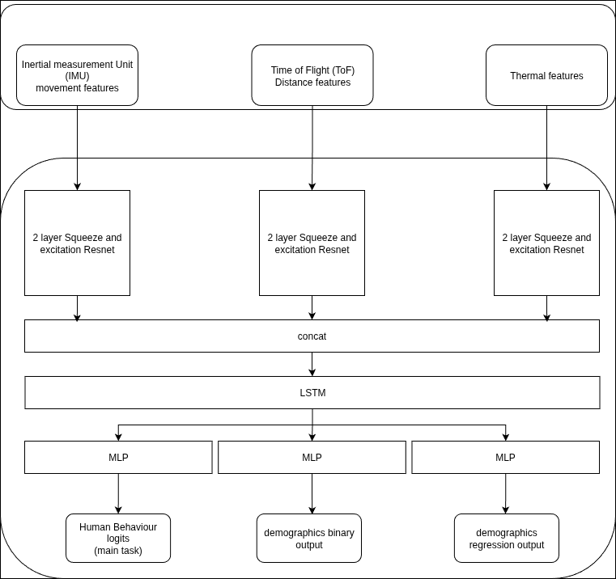

# [Child Mind Institute 2025 Kaggle Competition](https://www.kaggle.com/competitions/cmi-detect-behavior-with-sensor-data/overview)

### Score
I ranked [**146th out of 2600**]() participants with an **0.83 F1 score** as a **solo competitor**.  

### Problem
Here is a snippet of the competition's overview:  
> Body-focused repetitive behaviors (BFRBs), such as hair pulling, skin picking, and nail biting, are self-directed habits involving repetitive actions that, when frequent or intense, can cause physical harm and psychosocial challenges.  
> These behaviors are commonly seen in anxiety disorders and obsessive-compulsive disorder (OCD), thus representing key indicators of mental health challenges.  
> To investigate BFRBs, the Child Mind Institute has developed a wrist-worn device, Helios, designed to detect these behaviors.  
> While many commercially available devices contain Inertial Measurement Units (IMUs) to measure rotation and motion, the Helios watch integrates additional sensors, including 5 thermopiles (for detecting body heat) and 5 time-of-flight sensors (for detecting proximity).  
>   

In summary, this is a [Human Activity Recognition](https://www.geeksforgeeks.org/deep-learning/human-activity-recognition-using-deep-learning-model/) (HAR) competition.

### Solution
#### Model
The model is three ResNets (with squeeze and excitation blocks) branches followed by an LSTM and three MLP heads for each learning task.  

#### Training
The dataset is first split into training/validation splits.  
The training split is further divided into folds with sklearn's `StratifiedGroupKFold`,  
where K (the number of folds) = 20, grouped by subject and the target is the human activity.  
Each model is trained with early stopping based on the loss of its respective cross-validation split.  
I then perform hyperparameter tuning. I use the ensemble of the K models’ ensemble loss on the validation split.  
The model is mainly trained on the Human Activity Recognition (HAR) task.  
In addition, the model is trained on auxiliary tasks with lower loss weights.  
These auxiliary tasks are:  
- the orientation of the subject (standing up, sitting down, etc.) during the activity  
- the sex of the subject  
- the height  
- and other features that you can find in the [data description](https://www.kaggle.com/competitions/cmi-detect-behavior-with-sensor-data/data) of the competition.  

Incorporating these auxiliary tasks improved generalization and training stability,  
enabling the model to achieve performance comparable (slightly lower) to top public submissions using a single unified architecture.

#### Ensemble
My submission is an ensemble of 20 (one for each fold) models.  
The model ensemble logits is the average of the 20 models' logits.  
I then average these logits with the ensemble of a public solution.  
Interstingly enough, my best submission did not use the best performing public notebook.  